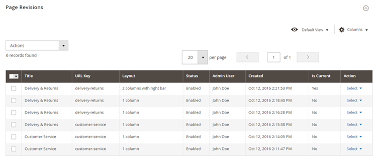
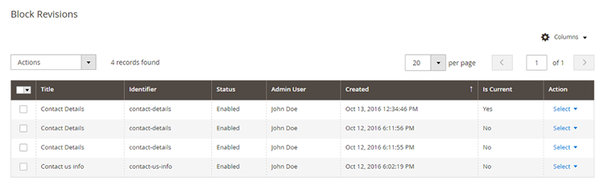

# Using the CMS Revisions Extension

After installing Magento 2 CMS Revisions, the extension will automatically create a backup each time a content page or block is saved, enabling you to easily manage, preview and restore CMS revisions in the Admin Panel.

## Managing CMS Page Revisions

To manage CMS page revisions, navigate to **Content > Pages** in the left Admin Panel menu, select a page from the grid using the 'Edit' option in the 'Action' column and scroll down to the **Page Revisions** tab in the page view.

The Page Revisions tab shows an overview of all saved page revisions with the current version marked with 'Yes' in the 'Is Current' column.

By default the overview shows the page revision title, URL key, layout, status, admin user and creation date. You can add and remove columns using the 'Columns' menu in the top right corner of the Page Revisions tab.

The 'Action' column can be used to restore, preview and delete a CMS page revision.

Use the 'Restore' option to directly recover a CMS page revision.

The 'Preview' option opens a front-end example of the CMS page revision in a new window.

Use the 'Delete' option to permanently remove page revisions. You can remove multiple revisions at once by selecting them from the overview and using the 'Delete' option in the 'Actions' dropdown menu in the top left corner of the Page Revisions tab.

## Managing CMS Block Revisions

To manage CMS block revisions, navigate to **Content > Blocks** in the left Admin Panel menu, select a block from the overview using the 'Edit' option in the 'Action' column and scroll down to the **Block Revisions** tab in the block detail page.

The Block Revisions tab shows an overview of all saved block revisions with the current version marked with 'Yes' in the 'Is Current' column.

By default the overview shows the block revisions title, identifier, status, admin user and creation date. You can add and remove columns using the 'Columns' menu in the top right corner of the Block Revisions tab.

The 'Action' column can be used to edit, restore and delete a CMS block revision.

Use the 'Edit' option to load and modify a block revision in the content editor. Please note that this option is not available when using the Page Builder module.

Use the 'Restore' option to directly recover a CMS block revision.

Use the 'Delete' option to permanently remove block revisions. You can delete multiple revisions at once by selecting them from the overview and using the 'Delete' option in the 'Actions' dropdown menu in the top left corner of the Block Revisions tab.

---

[Documentation index](./README.md) · [README](../README.md) · [Online version](https://plugin.company/knowledge-base/docs/magento2-cms-revisions/user-manual/using-the-cms-revisions-extension/)
